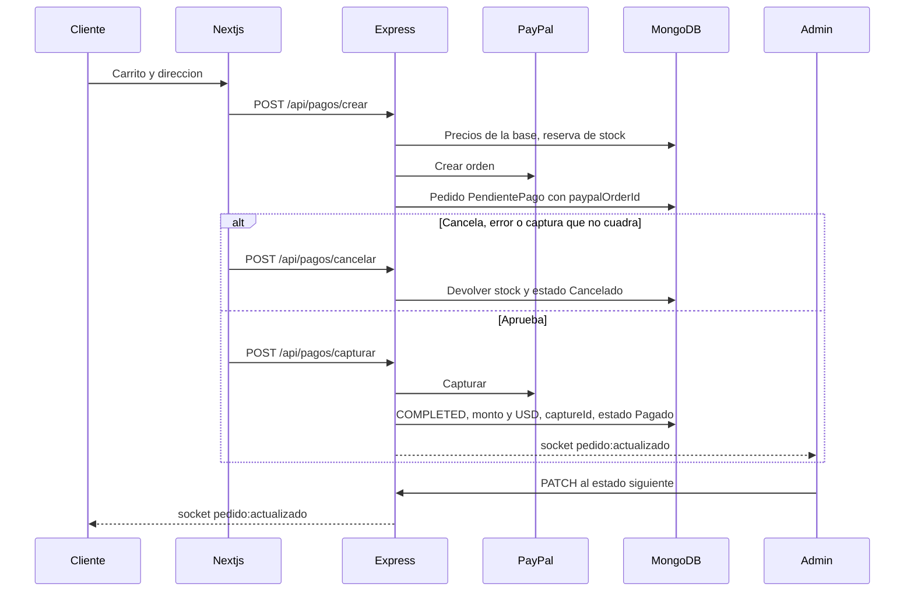

# LibroYa: librería virtual full-stack

Aplicación en español, sin tienda física: catálogo con stock de bodega, envío a domicilio, pago con PayPal Sandbox y seguimiento del pedido en tiempo real.

Al construir, después de cada tarea de abajo: resumir archivos modificados, decisiones tomadas, comandos ejecutados y pruebas que siguen pendientes.

## Arquitectura

Dos procesos independientes, cada uno con su `package.json`:

- [frontend](frontend): Next.js (App Router) + React + Tailwind. Sin API Routes ni acceso directo a MongoDB. Habla con el backend por HTTP y Socket.IO.
- [backend](backend): Express + Socket.IO + Mongoose. Única fuente de las APIs, la validación de stock, el recálculo de precios y la confirmación de PayPal.

Puertos locales: frontend `3000`, backend `process.env.PORT` o `4000`. El proceso escucha en `0.0.0.0`. CORS de Express y de Socket.IO usan el mismo `CLIENT_URL`. `.env` está en `.gitignore` y no se commitea.

[backend/.env.example](backend/.env.example): `MONGODB_URI`, `JWT_SECRET`, `CLIENT_URL` (`http://localhost:3000` en local), `PAYPAL_CLIENT_ID`, `PAYPAL_CLIENT_SECRET`, `PAYPAL_API_BASE` (`https://api-m.sandbox.paypal.com`), `SEED_ADMIN_EMAIL`, `SEED_ADMIN_PASSWORD`.

[frontend/.env.example](frontend/.env.example): `NEXT_PUBLIC_API_URL` (`http://localhost:4000` en local) y `NEXT_PUBLIC_PAYPAL_CLIENT_ID`. Las llamadas a PayPal del servidor usan `PAYPAL_API_BASE`.

JavaScript en ambos lados (sin TypeScript).

## Modelo de datos

Todos los esquemas usan `timestamps: true` (`createdAt`, `updatedAt`).

- **Usuario**: `nombre`, `email` único, `password` (bcrypt), `rol` (`cliente` | `admin`).
- **Libro**: `titulo`, `autor`, `descripcion`, `precio`, `stock`, `categoria`, `imagen` (URL), `activo`.
- **Pedido**: `usuario`, `items` (libro, título, cantidad, precio congelado al crear el pago), `direccion` (calle, ciudad, región, código postal, teléfono), `total`, `moneda` (`USD`), `estado` (`PendientePago` | `Cancelado` | `Pagado` | `Preparando` | `Despachado` | `Entregado`), `paypalOrderId` único, `captureId`.

El carrito vive en el cliente (`localStorage` + contexto React). El backend no confía en precios ni totales enviados por el navegador.

`GET /api/pedidos` (historial y Kanban) solo devuelve `Pagado`, `Preparando`, `Despachado` y `Entregado`. `PendientePago` y `Cancelado` quedan fuera de esas pantallas.

## Backend

Entrada en [backend/src/index.js](backend/src/index.js): Express, `app.set("trust proxy", 1)`, `helmet`, CORS con `CLIENT_URL`, JSON, `GET /health` sin auth (`200` y `{ ok: true }`), rutas y Socket.IO sobre el mismo HTTP server. El constructor de Socket.IO usa `cors.origin` igual a `CLIENT_URL`. Arranque: `server.listen(process.env.PORT || 4000, "0.0.0.0")`. Script `start`: `node src/index.js`. El frontend tiene `start`: `next start`. `trust proxy` hace que el límite de intentos lea la IP del cliente detrás del proxy de Railway.

Rutas:

- **Auth** — `POST /api/auth/registro` (siempre `cliente`), `POST /api/auth/login`, `GET /api/auth/me`. JWT en `Authorization: Bearer`. Registro público no puede elegir rol. `express-rate-limit` solo en login y registro: 10 intentos fallidos por 15 minutos por IP, con `skipSuccessfulRequests: true`. Un login o registro que responde éxito no consume cupo. El undécimo fallo en la ventana responde `429`.
- **Libros** — `GET /api/libros` (filtros `categoria` y `q`), `GET /api/libros/categorias`, `GET /api/libros/:id` públicos. `POST`, `PUT`, `PATCH /:id/stock` y desactivar (`activo: false`) solo admin.
- **Pedidos** — `GET /api/pedidos` (cliente: solo los suyos; admin: todos; ambos sin `PendientePago` ni `Cancelado`), `GET /api/pedidos/:id` (dueño o admin), `PATCH /api/pedidos/:id/estado` solo admin. La cadena permitida es un solo paso: `Pagado` → `Preparando` → `Despachado` → `Entregado`. Cualquier otro destino responde `400` y no cambia el documento.
- **Pagos** — solo cliente autenticado:
  - `POST /api/pagos/crear`
  - `POST /api/pagos/capturar`
  - `POST /api/pagos/cancelar`

Pago, en [backend/src/routes/payments.js](backend/src/routes/payments.js):

1. **Crear.** Recalcular cada ítem con el precio vigente en MongoDB. Rechazar libros inactivos o cantidades inválidas. Reservar stock con `findOneAndUpdate` condicional (`stock >= cantidad` y `$inc` negativo). Si alguna reserva falla, devolver el stock ya descontado y responder error, sin dejar un pedido. Crear la orden en PayPal Sandbox (Orders v2) por el total del servidor y moneda `USD`. Si PayPal falla, devolver el stock. Si PayPal responde, guardar el pedido en `PendientePago` con usuario del token, ítems a precio congelado, total, `moneda: "USD"` y `paypalOrderId` único.
2. **Cancelar.** Lo llama el frontend en `onCancel` y `onError` del botón. Busca el pedido por `paypalOrderId`, exige que sea del usuario del token y que esté en `PendientePago`, pasa a `Cancelado` y devuelve el stock una sola vez. Un segundo cancelar del mismo pedido no vuelve a sumar stock.
3. **Capturar.** Busca el pedido por `paypalOrderId` y exige que sea del usuario del token. Si el estado ya es `Pagado`, responde ese pedido y su `captureId` sin llamar otra vez a PayPal, sin crear otro documento y sin tocar el stock. Si sigue en `PendientePago`, captura en PayPal y exige estado `COMPLETED`, monto igual al `total` guardado y moneda `USD`. Si cuadra, guarda `captureId` y pasa a `Pagado` con una actualización condicionada al estado anterior, para que dos capturas paralelas no dupliquen. Si la captura falla o el monto o la moneda no cuadran, devuelve el stock y deja el pedido en `Cancelado`, sin `captureId` de un pago aceptado.

El stock baja en la reserva de `POST /api/pagos/crear`. Se devuelve si el pago se cancela, si PayPal falla al crear o al capturar, o si la captura no queda `COMPLETED` con el monto y la moneda del pedido.

Middleware [backend/src/middleware/auth.js](backend/src/middleware/auth.js): `proteger` (JWT válido) y `autorizar(...roles)`. Un pedido de otro usuario responde `403`.

Socket.IO en [backend/src/sockets/index.js](backend/src/sockets/index.js): el handshake exige el mismo JWT. El cliente entra a la sala `user:{id}`; el admin a `admins`. Evento `pedido:actualizado` al pasar a `Pagado` y al avanzar el estado en el Kanban. `PendientePago` y `Cancelado` no se emiten a esas pantallas.

Seed [backend/src/seed/seed.js](backend/src/seed/seed.js) con `node src/seed/seed.js`:

- El admin sale de `SEED_ADMIN_EMAIL` y `SEED_ADMIN_PASSWORD`. Si falta alguna, el script termina con error. No hay contraseña ni email de admin escritos en código ni en el README.
- Unos 12 libros de ejemplo en categorías como Ficción, No ficción, Infantil, Ciencia e Historia, con stock y portadas por URL.

Validación de entradas con Zod. Errores en un manejador central con mensajes en español.

## Frontend

App Router, Tailwind, UI en español, mobile-first. Paleta de librería: fondo papel (`#f6f1e7`), tinta (`#1c1917`), acento terracota. Tipografía con una serif para títulos y sans para UI.

Páginas:

- `/` catálogo con filtro por categoría y búsqueda.
- `/libros/[id]` detalle, stock visible y agregar al carrito.
- `/carrito` cantidades y enlace a checkout (exige sesión).
- `/checkout` dirección de entrega, resumen con el total devuelto por `POST /api/pagos/crear`, botón PayPal Sandbox. `onCancel` y `onError` llaman a `POST /api/pagos/cancelar` con el `paypalOrderId`.
- `/pedidos` historial del cliente, solo estados visibles. Escucha `pedido:actualizado` y actualiza sin recargar.
- `/login` y `/registro`.
- `/admin` redirige a `/admin/pedidos`. No hay página de resumen.
- `/admin/libros` alta, edición, stock y activar/desactivar.
- `/admin/pedidos` Kanban con columnas `Pagado`, `Preparando`, `Despachado` y `Entregado`, arrastre con `@dnd-kit`. Al soltar se envía el `PATCH`. Si el destino no es el estado siguiente, el backend responde error y la tarjeta vuelve a su columna. El tablero también escucha el socket.

Contextos: `AuthProvider` (token en `localStorage`, usuario en memoria) y `CartProvider`. Guardas de cliente: checkout para usuarios logueados; layout de admin solo si `rol === "admin"`. El backend sigue siendo la autoridad.

Cliente HTTP en [frontend/lib/api.js](frontend/lib/api.js) y socket en [frontend/lib/socket.js](frontend/lib/socket.js) (`NEXT_PUBLIC_API_URL`).

## Cómo se ejecuta

[README.md](README.md) con: cluster en Atlas, `MONGODB_URI`, app REST de PayPal Developer (Sandbox), Client ID y Secret, definir `SEED_ADMIN_EMAIL` y `SEED_ADMIN_PASSWORD` en `.env` antes del seed, y levantar backend y frontend. El README no incluye una contraseña de ejemplo.

Despliegue del backend en Railway: `GET /health`, `PORT` inyectado por la plataforma, escucha en `0.0.0.0`, script `start`.

El stock se reserva al crear el pago y se devuelve si el pago se cancela, falla o la captura no cuadra.

## Tareas y criterios de aceptación

### backend-base

Scaffold Express + Socket.IO, Mongoose, modelos y seed.

- `GET /health` responde `200` con `{ ok: true }` sin token.
- Con `PORT=3999`, el proceso acepta conexiones en `0.0.0.0:3999`.
- Un documento nuevo de Usuario, Libro y Pedido persiste `createdAt` y `updatedAt`.
- El seed aborta si faltan `SEED_ADMIN_EMAIL` o `SEED_ADMIN_PASSWORD`. Con ambas definidas, crea un admin con ese email y libros de ejemplo. Esas credenciales no aparecen en el código ni en el README.

### backend-api

Auth, libros, pedidos y pagos.

- El registro crea `cliente` aunque el cuerpo pida `admin`. Login devuelve un JWT y `GET /api/auth/me` lo reconoce. Diez logins correctos seguidos no disparan el límite. El undécimo intento fallido de login o registro desde la misma IP, dentro de 15 minutos, responde `429`. Un login correcto intercalado no cuenta como intento.
- No existe `GET /api/usuarios`.
- Un cliente que crea un libro recibe `403`; un admin lo crea y cambia el stock.
- `POST /api/pagos/crear` guarda `PendientePago`, precio congelado, total calculado en el servidor, `moneda: "USD"` y `paypalOrderId` único, y el stock de bodega baja en esa llamada. Un precio enviado por el cliente distinto al de la base no cambia el total.
- `POST /api/pagos/cancelar` deja `Cancelado` y repone el stock. Llamarlo de nuevo no suma el stock otra vez.
- `POST /api/pagos/capturar` rechaza el pedido de otro usuario. Con captura `COMPLETED`, monto y `USD` correctos, guarda `captureId` y pasa a `Pagado`. Si el pedido ya está `Pagado`, la respuesta es ese mismo resultado y el stock no se mueve. Si la captura no cuadra, el stock vuelve y el estado queda `Cancelado`.
- `PATCH /api/pedidos/:id/estado` de `Pagado` a `Preparando` responde `200`. De `Pagado` a `Despachado` o hacia atrás responde `400` y el estado guardado no cambia.
- `GET /api/pedidos` no incluye documentos en `PendientePago` ni `Cancelado`.

### backend-socket

- Un cliente con JWT y `Origin` igual a `CLIENT_URL` entra a su sala, y un admin a `admins`. Sin token, la conexión se rechaza. Un `Origin` distinto de `CLIENT_URL` no supera el CORS de Socket.IO.
- Al capturar con éxito y al avanzar de `Pagado` a `Preparando`, el evento `pedido:actualizado` llega a la sala del dueño y a `admins`.
- Cancelar un `PendientePago` no emite ese evento.

### backend-tests

Pruebas de integración en el backend (`npm test`), con MongoDB en memoria y el cliente de PayPal sustituido por un doble de prueba:

- Login: registro, login y `/me` con el token.
- Permisos por rol: un cliente no crea libros; un admin sí.
- Pedido ajeno: el dueño lee el suyo; otro cliente recibe `403`.
- Total calculado en el servidor: un precio falso en el cuerpo no altera el `total` guardado.
- Captura repetida: dos capturas del mismo `paypalOrderId` dejan un solo pedido `Pagado`, un solo `captureId` y el mismo stock.
- Compra simultánea de la última unidad: dos `POST /api/pagos/crear` sobre el único ejemplar; uno reserva y el otro falla; el stock termina en 0 y hay un solo `PendientePago` de ese libro.

### frontend-shell

- En viewport estrecho el menú se usa sin solaparse con el contenido.
- Registro y login dejan la sesión usable en una recarga (el token sigue en `localStorage` y `/me` responde).
- El carrito conserva cantidades tras recargar y sobrevive a cerrar sesión solo como borrador local; el checkout exige sesión.

### frontend-shop

- El catálogo filtra por categoría y la ficha muestra el stock.
- En checkout, el total mostrado es el de `POST /api/pagos/crear`.
- `onCancel` y `onError` del botón llaman a `POST /api/pagos/cancelar`.
- El historial no lista `PendientePago` ni `Cancelado`. Con la página abierta, un `pedido:actualizado` cambia la etiqueta de estado sin recargar.

### frontend-admin

- Entrar a `/admin` termina en `/admin/pedidos`. No hay pantalla de resumen.
- El admin crea un libro, edita su stock y lo desactiva; el catálogo público deja de ofrecerlo al desactivarlo.
- Soltar una tarjeta `Pagado` sobre `Preparando` la deja ahí. Soltarla sobre `Despachado` o `Entregado` muestra el error y la tarjeta queda en `Pagado`.
- Un cambio de estado hecho en otra sesión aparece en el tablero sin recargar.

### readme

- `backend/.env.example` incluye `CLIENT_URL` y `PAYPAL_API_BASE=https://api-m.sandbox.paypal.com`, además del resto de variables del servidor. `frontend/.env.example` incluye `NEXT_PUBLIC_API_URL` y `NEXT_PUBLIC_PAYPAL_CLIENT_ID`. Ningún ejemplo trae una contraseña real. El README explica cómo rellenarlas, cómo correr el seed y los dos procesos, y cómo comprobar `GET /health`.
- `.gitignore` ignora `.env`. `git status` no muestra `.env` después de crearlo en local.
- `npm start` en el backend arranca `node src/index.js`.
