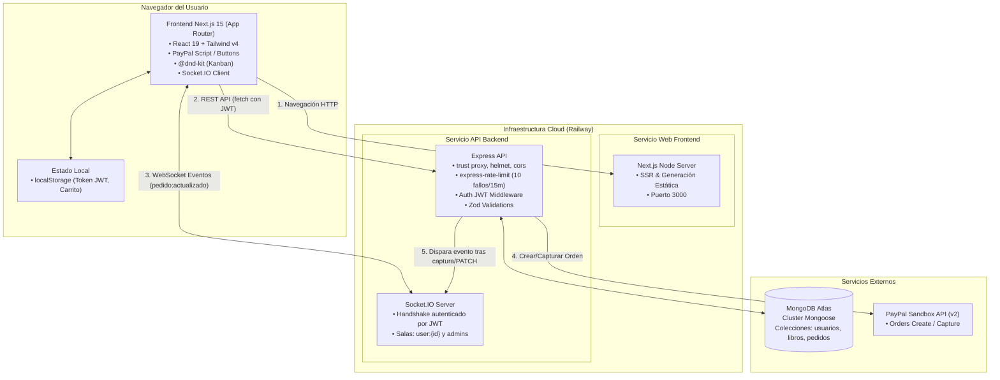
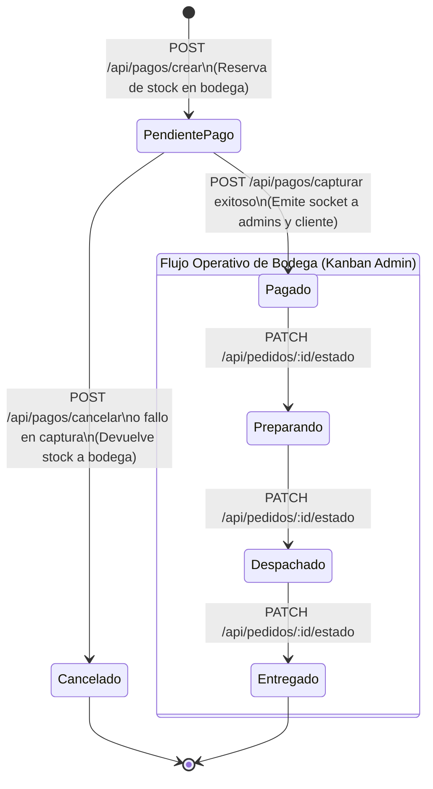

# Arquitectura del Sistema (LibroYa)

Este documento detalla la estructura técnica, componentes, modelos de datos, flujos de integración y seguridad implementados en la plataforma **LibroYa**.

---

## 1. Diagrama de Arquitectura



---

## 2. Justificación de Decisiones Técnicas

| Decisión | Alternativa Evaluada | Justificación |
| :--- | :--- | :--- |
| **Separación de Procesos (Next.js y Express)** | Monolito exclusivo en Next.js (Server Actions / Route Handlers) | Next.js en entornos serverless o contenedores estándar dificulta mantener conexiones persistentes y con estado de **WebSockets (Socket.IO)** con handshake JWT. Separar el backend permite escalar la API y los sockets de forma independiente. |
| **Reserva Atómica en Creación de Pago** | Descontar stock tras confirmar el pago en PayPal | Si se descuenta al final, dos clientes pueden iniciar el pago de la última unidad y uno de ellos pagará por un producto sin stock. Reservar al crear (`$inc: -1` condicionado) garantiza que solo quien reservó pueda pagar; si cancela, se repone. |
| **Recálculo de Totales en Servidor** | Confiar en el subtotal enviado por el carrito | La seguridad exige confianza cero en el cliente. El backend reconstruye los ítems consultando la colección de libros en MongoDB antes de generar la orden en PayPal. |
| **Control de Estados Unidireccional** | Estados libres asignados por el admin | Previene errores operativos en la bodega (por ejemplo, marcar un paquete como "Entregado" cuando ni siquiera ha sido "Preparado" o "Despachado"). |
| **Handshake Autenticado en Sockets** | Sockets abiertos con filtrado en eventos | Exigir el token JWT en la conexión inicial asegura que solo usuarios legítimos accedan a la red de sockets, asociándolos de inmediato a su sala privada (`user:{id}`) o a la sala de operadores (`admins`). |

---

## 3. Modelos de Datos (Mongoose)

Todos los modelos se definen con la opción `{ timestamps: true }`, persistiendo automáticamente `createdAt` y `updatedAt`.

### A. Usuario (`Usuario.js`)
```javascript
{
  nombre:    { type: String, required: true, trim: true },
  email:     { type: String, required: true, unique: true, lowercase: true, trim: true },
  password:  { type: String, required: true }, // Hash bcrypt
  rol:       { type: String, enum: ["cliente", "admin"], default: "cliente" }
}
```

### B. Libro (`Libro.js`)
```javascript
{
  titulo:      { type: String, required: true, trim: true },
  autor:       { type: String, required: true, trim: true },
  descripcion: { type: String, required: true },
  precio:      { type: Number, required: true, min: 0 },
  stock:       { type: Number, required: true, min: 0, default: 0 },
  categoria:   { type: String, required: true, trim: true },
  imagen:      { type: String, required: true },
  activo:      { type: Boolean, default: true }
}
```

### C. Pedido (`Pedido.js`)
```javascript
{
  usuario: { type: ObjectId, ref: "Usuario", required: true },
  items: [
    {
      libro:    { type: ObjectId, ref: "Libro", required: true },
      titulo:   { type: String, required: true },
      cantidad: { type: Number, required: true, min: 1 },
      precio:   { type: Number, required: true } // Congelado al momento del pago
    }
  ],
  direccion: {
    calle:        { type: String, required: true },
    ciudad:       { type: String, required: true },
    region:       { type: String, required: true },
    codigoPostal: { type: String, required: true },
    telefono:     { type: String, required: true }
  },
  total:          { type: Number, required: true },
  moneda:         { type: String, default: "USD" },
  estado: {
    type: String,
    enum: ["PendientePago", "Cancelado", "Pagado", "Preparando", "Despachado", "Entregado"],
    default: "PendientePago"
  },
  paypalOrderId:  { type: String, required: true, unique: true },
  captureId:      { type: String },
  stockLiberado:  { type: Boolean, default: false } // Bandera de idempotencia al devolver stock
}
```

---

## 4. Tabla de Endpoints y Reglas de Autorización

| Método | Endpoint | Autenticación | Rol Permitido | Descripción / Regla de Negocio |
| :--- | :--- | :--- | :--- | :--- |
| `GET` | `/health` | Pública | Cualquiera | Health check que responde `{ ok: true }` con HTTP 200. |
| `POST`| `/api/auth/registro` | Pública | Cualquiera | Crea únicamente cuentas con `rol: "cliente"`. Rate limit: 10 fallos / 15 min. |
| `POST`| `/api/auth/login` | Pública | Cualquiera | Emite JWT. Rate limit: 10 fallos / 15 min con `skipSuccessfulRequests: true`. |
| `GET` | `/api/auth/me` | JWT Bearer | `cliente`, `admin` | Devuelve el perfil del usuario autenticado a partir del token. |
| `GET` | `/api/libros` | Pública | Cualquiera | Catálogo con filtros `categoria` y `q`. Solo lista libros con `activo: true`. |
| `GET` | `/api/libros/categorias` | Pública | Cualquiera | Lista única de categorías de libros activos. |
| `GET` | `/api/libros/:id` | Pública | Cualquiera / Admin| Detalle de libro. Si está inactivo, solo un admin puede consultarlo (o 404). |
| `GET` | `/api/libros/admin/todos` | JWT Bearer | `admin` | Lista todos los libros (activos e inactivos) para gestión de inventario. |
| `POST`| `/api/libros` | JWT Bearer | `admin` | Da de alta un nuevo libro en bodega. |
| `PUT` | `/api/libros/:id` | JWT Bearer | `admin` | Actualiza datos de un libro o cambia su bandera `activo`. |
| `PATCH`| `/api/libros/:id/stock`| JWT Bearer | `admin` | Modifica directamente el stock numérico del libro en bodega. |
| `POST`| `/api/pagos/crear` | JWT Bearer | `cliente` | Valida stock, reserva atómicamente, crea orden en PayPal y guarda `PendientePago`. |
| `POST`| `/api/pagos/cancelar`| JWT Bearer | `cliente` | Cancela pedido en `PendientePago` y devuelve stock reservado (idempotente). |
| `POST`| `/api/pagos/capturar`| JWT Bearer | `cliente` | Captura orden en PayPal. Si es válida, pasa a `Pagado` y emite socket. |
| `GET` | `/api/pedidos` | JWT Bearer | `cliente`, `admin` | Omite `PendientePago` y `Cancelado`. Cliente lee solo los suyos; admin lee todos. |
| `GET` | `/api/pedidos/:id` | JWT Bearer | Dueño / `admin` | Detalle del pedido. Un cliente ajeno recibe `403 Forbidden`. |
| `PATCH`| `/api/pedidos/:id/estado`| JWT Bearer | `admin` | Avanza exactamente al estado siguiente. Error `400` ante cualquier salto inválido. |

---

## 5. Máquina de Estados del Pedido

El ciclo de vida del pedido se gestiona con una máquina de estados estricta:



### Reglas de Transición:
1. **Estados Transitorios (Ocultos):** `PendientePago` y `Cancelado` nunca se exponen en las listas de pedidos del cliente ni en el tablero de bodega.
2. **Paso Estricto:** La transición en bodega solo admite un salto hacia adelante a la vez:
   - `Pagado` $\rightarrow$ `Preparando`
   - `Preparando` $\rightarrow$ `Despachado`
   - `Despachado` $\rightarrow$ `Entregado`
3. **Rechazo y Consistencia:** Intentar saltar de `Pagado` a `Despachado` o intentar retroceder devuelve un error HTTP 400 y el estado permanece inalterado.

